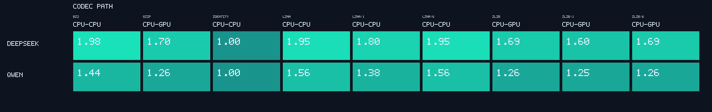

# Classic BF16 KV-cache benchmark — 2026-11-17

Full-dataset results completed on the shared benchmark server on 2026-11-17 at approximately 18:30 (Asia/Shanghai). This is the completed mixed CPU/GPU run, not a validation-only sample and not an all-optional-codec run.

- **26 measured configurations:** 18 CPU→CPU and 8 CPU→GPU.
- **72,618 verified blocks:** every reported block passed byte-exact decoding verification.
- **Nine codec/parameter names:** identity, gzip, bz2, lzma, lzma:1, lzma:6, zlib, zlib:1, zlib:6.
- **DeepSeek BF16:** 5,074 KV pages; nominal page size 128 KiB; 664,663,040 input bytes.
- **Qwen BF16:** 512 KV pages; nominal page size 1 MiB; 536,870,912 input bytes.
- CPU encoding uses one thread. GPU decode uses batches of up to 256 pages. Compatible CPU/GPU decoder rows share the same encoder measurement and frame format; eight shared groups were checked.

## Files

- [result.csv](result.csv): complete numerical results, timing scopes, fingerprints and verification counts.
- [heatmap.html](heatmap.html): standalone interactive offline report; download and open locally.
- [heatmap.png](heatmap.png): static report preview.
- [capabilities.json](capabilities.json): declared execution/decoder capabilities.
- [unavailable_codecs.json](unavailable_codecs.json): no unavailable selected codecs were recorded.
- [summary.json](summary.json): machine-readable run scope and validation totals.

Codec-only throughput excludes preparation, transfer and correctness checks; page-level throughput includes the separately measured page overhead. Use the CSV timing-scope fields when comparing results. Shared-server measurements are snapshots, not hardware-independent performance guarantees.

The results were produced before the entrypoint and publication cleanup; CSV fingerprints identify the measured configurations. No rerun against the final publication commit is implied. Raw input tensors, local settings, job metadata, temporary frames and the large resume journal are retained outside this public bundle. Hardware/dependency details are not included in this export.
